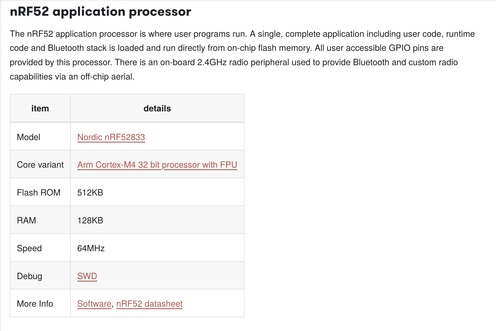
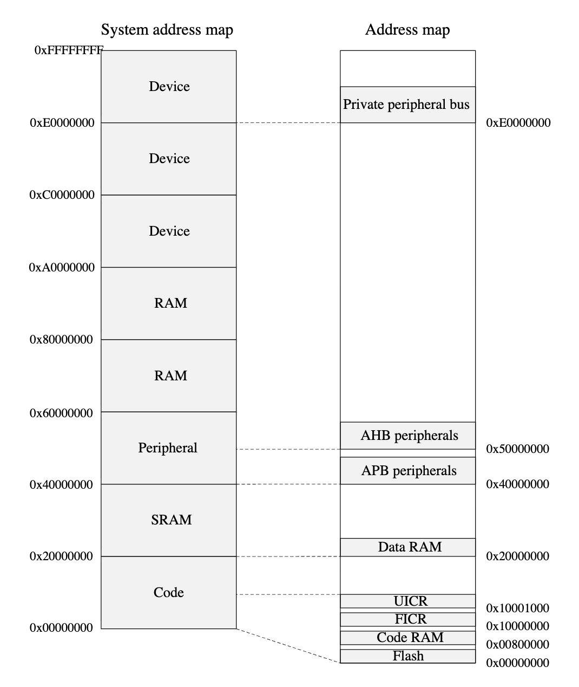

# rustymicrobit

## setup

- Hardware: Microbit BBC v2

- Cross compilation: RustC/LLVM Target Triple

```
<arch><sub>-<vendor>-<sys>-<envabi>
arch: x86_64, i86, arm, ...
sub: [ex. arm] v5, v6, v7m, ...
vendor: [optional] pc, apple, ibm, ...
sys: non, linux, win32, darwin, ...
env: eabi, gnu, elf, ...
``` 
- Microbit / hardware  [nRF52 application processor](https://tech.microbit.org/hardware/2-2-revision/#nrf52-application-processor)
  - Model: Nordic nRF52833
  - Core variant: Arm Cortex-M4 32 bit processor with FPU

- Arm Support / [Cortex-M4](https://support.arm.com/compute-ip/cortex-m4)
  - Architecture: Armv7E-M
  - ISA Support: Thumb or Thumb-2 

- RustC / [Platform Support](https://doc.rust-lang.org/beta/rustc/platform-support.html)
  - Potential systems you can target 
  - [ARMv7EM with NuttX, hardfloat](https://doc.rust-lang.org/beta/rustc/platform-support/nuttx.html) 

- Add support for the board

```bash
rustup target list | grep thumbv7em
# thumbv7em-none-eabi
# thumbv7em-none-eabihf

rustup target add thumbv7em-none-eabihf

rustup show
# active toolchain
# ----------------
# name: stable-aarch64-apple-darwin
# active because: it's the default toolchain
# installed targets:
#   aarch64-apple-darwin
#   thumbv7em-none-eabihf
```

- Tell the compiler to exclude the standard library and its main function.

```rust
#![no_std]
#![no_main]
```

- How does the code gets properly located in our microcontroller's memory map?
  - This is addressed in the [cortex-m-rt](https://docs.rs/cortex-m-rt/0.7.7/cortex_m_rt/) crate, which includes a `linked` script

- What does it need from us? A `memory.x` file which minimally needs to contain both the start address and size of the `Flash` and `RAM` regions of memory for our specific microcontroller.
  - [nrf52-application-processor](https://tech.microbit.org/hardware/2-2-revision/#nrf52-application-processor)
  - Flash ROM: 512KB
  - RAM: 128KB

- Microcontroller's memory map
  - nRF52833 Product Specification / Core components / [Memory](https://docs.nordicsemi.com/r/bundle/ps_nrf52833/page/memory.html)
  - Flash starts at `0x00000000`
  - RAM starts half a Gigabyte later at `0x20000000`

- Add cargo dependency

```bash
cargo add cortex-m-rt
```

- Add `memory.x` file

- The entry attribute requires that the function signature never returns: `!` return type

- Let the Rust compiler know that it needs to run the linker script anytime that it rebuilds our project by:
  - (A) passing some arguments
  - (B) creating a `.cargo/config.toml` Cargo configuration file for the project.

- We need to tell the Rust Analyzer plugin to check for errors in our target of interest, by creating a configuration file `.vscode/settings.json` for VsCode. 

- We need a `panic_handler` function, even if it doesn't get linked in the compiler stills wants it defined.
  - The easiest way is to pull in the panic_halt` crate 

```bash
cargo add panic_halt
```

- To make sure the compiler sees it we add it to our `main.rs` file

```rust
use panic_halt as _;
```

- Build the code and then look at the file before moving it to the microcontroller

```bash
cargo build
```

- Add the LLVM utils component, which gives us bin utils like `size` and obge dump for getting info about the binary and viewing this assembly.

```bash
rustup component  add llvm-tools
```

- The ergonomics of calling this directly for our target binary aren't great. So, we're also gonna install a sub-command for cargo called `cargo-binutils`, which is a wrapper around LLVM tools that makes it easier to use.

```bash
cargo install cargo-binutils
```

- For `cargo-binutils` we need to specify the LLVM tool we want. Let's try `size`.

```bash
cargo size -- -Ax

# rustymicrobit  :
# section                size         addr
# .vector_table         0x400          0x0
# .text                  0x80        0x400
# .rodata                   0        0x480
# .data                     0   0x20000000
# .gnu.sgstubs              0        0x480
# .bss                      0   0x20000000
# .uninit                   0   0x20000000
# .debug_abbrev        0x139a          0x0
# .debug_info         0x29288          0x0
# .debug_aranges       0x14a0          0x0
# .debug_ranges       0x12df0          0x0
# .debug_str          0x47caf          0x0
# .comment               0x99          0x0
# .ARM.attributes        0x3a          0x0
# .debug_frame         0x4e58          0x0
# .debug_line         0x2585c          0x0
# Total               0xb1168
```

- To flash this code into our board we install `cargo-embed` which is going to 
  - Rebuild our code and talk with our secondary debug microcontroller
  - Send it our binary and have it program our primary microcontroller
  - Allow us to connect a debugger

```bash
cargo install cargo-embed

# `cargo-embed` is now a part of `probe-rs`. To install it, run the following command:
# curl --proto '=https' --tlsv1.2 -LsSf https://github.com/probe-rs/probe-rs/releases/latest/download/probe-rs-tools-installer.sh | sh
```

- We minimally need to specify the microcontroller that we'll be programming

```bash
# cargo embed --list-chips | grep -i nrf52833 : error

probe-rs chip list | grep -i nrf52833
# nRF52833_xxAA

cargo embed --chip nRF52833_xxAA
```

- Dump this chip info into a configuration file so I don't have to re-enter it the next time we run it by creating a `Embed.toml` file.

```bash
cargo embed
```

## reference

- [Embedded Rust setup explained](https://www.youtube.com/watch?v=TOAynddiu5M)

## attachments



